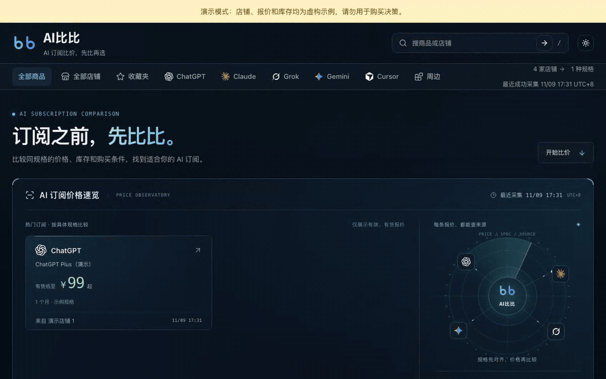
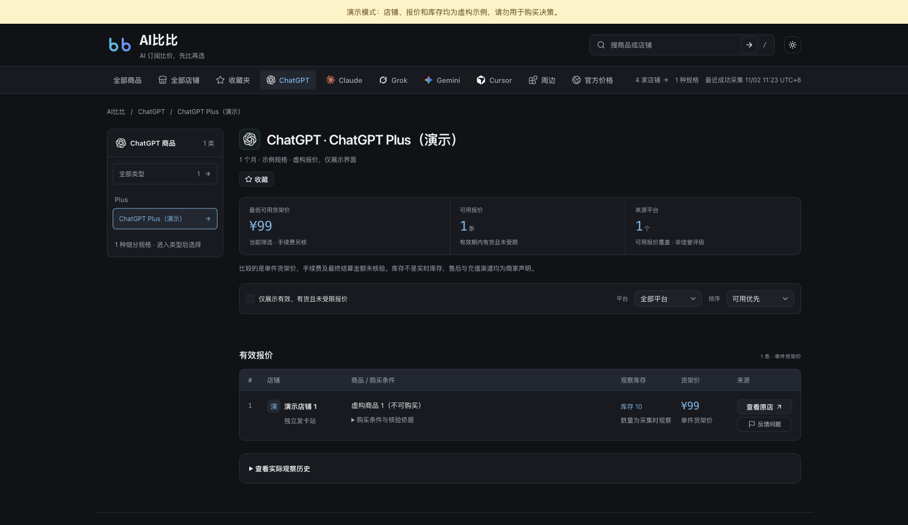
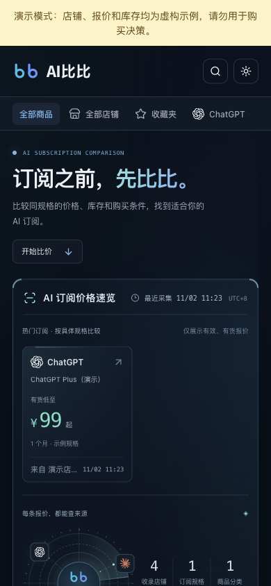

# aibibi · AI Subscription Comparison

English · [简体中文](README.md)

**Where is the same AI subscription cheapest?** aibibi lines up ChatGPT, Claude, Gemini and other subscriptions by identical plan specs, compares price, stock and purchase terms across shops, and shows official prices by region for reference. Every quote links to its source and the time it was collected.

You can deploy it yourself: Python collection and review · React + Vite frontend · Cloudflare Workers + D1.

[](https://github.com/dingxiaopi/aibibi/actions/workflows/quality.yml)
[](LICENSE)

[Live site aibibi.app](https://aibibi.app) (Chinese) · [First real quote guide](public-docs/first-quote.md) · [Deployment](public-docs/deployment.md) · [Troubleshooting](public-docs/troubleshooting.md) · [v0.3.0 release notes](public-docs/releases/v0.3.0.md)

> The site UI and the detailed docs under `public-docs/` are written in Chinese.



<sub>Recorded from the local demo. Shops, quotes and stock are fictional; official prices come from the public snapshot bundled with the repository.</sub>

## Run the demo

Requires Node.js 22.18+. Regular collection also needs Python 3.9+, and the encrypted Actions state tool needs Python 3.11. macOS and Linux are supported.

```sh
git clone https://github.com/dingxiaopi/aibibi.git
cd aibibi/cloudflare
npm ci
npm run demo
```

Open <http://127.0.0.1:8787>. The demo uses its own local database with fictional shops and sample quotes. No Cloudflare login, real shops or AI key is needed.
If the port is taken, run `npm run demo -- --port 8790`.

## Screenshots



<details>
<summary>Mobile view</summary>



</details>

## What it does

- Compares quotes by plan spec, source shop, stock and purchase terms.
- Reviews each product's category once from the shop's detail page, then reuses that mapping to update price and stock.
- Keeps real observation times. Expired, sold-out, unknown-stock and unreviewed records never count toward the current in-stock lowest price.
- Collection saves progress per shop and resumes by stage; pushes are batched, verified and resumable.
- Includes a shop directory, official regional price reference, browser favorites and quote error reports.
- Brand, domain, sources, database and optional analytics are all configurable.

## Architecture

```text
Public shop listings and detail pages
  → Python collection / first-time category review
  → Private instance data / export bundle
  → Authenticated batched push
  → Worker + D1
  → SSR pages / React frontend / public query cache
```

Data updates and code deployment are independent. Collection runs manually by default; the open-source repository installs no scheduled jobs.
You can also [collect manually or on a schedule with GitHub Actions](public-docs/github-actions.md) from your own private repository, with encrypted state, so your machine does not need to stay online.

## Deploy your own

For a first install, follow the [first real quote guide](public-docs/first-quote.md): set up a local instance, collect from shops, complete the first review and verify a push, then deploy your own Cloudflare D1, Worker and secrets.
The first review can be done by hand without an AI key. Routine Actions runs only update existing mappings and never approve new products automatically. See [configuration](public-docs/configuration.md) for fields and [deployment](public-docs/deployment.md) for going live.

By default `.local/data/` holds shop configuration, review mappings, exclusions, collection snapshots and run state, and is not committed.
The repository includes generic plan definitions and fictional demo data, not the original instance's shops or quotes.

## Development

```sh
python3 -m unittest discover -s tests
cd cloudflare
npm ci
npm run check
npm test
npm run build
```

Tests use fixed fixtures and isolated databases and never contact real shops.
`npm run build` builds the frontend and runs a deployment dry run; it does not publish anything.

## Documentation (Chinese)

- [Architecture and data boundaries](public-docs/architecture.md)
- [First real quote guide](public-docs/first-quote.md)
- [Instance configuration](public-docs/configuration.md)
- [Deployment and demo](public-docs/deployment.md)
- [Collectors and adapter contributions](public-docs/collectors.md)
- [Official regional prices, tax and manual collection](public-docs/official-prices.md)
- [GitHub Actions collection](public-docs/github-actions.md)
- [Troubleshooting and feedback](public-docs/troubleshooting.md)
- [Release process](public-docs/release.md)
- [Contributing](CONTRIBUTING.md) · [Security](SECURITY.md)

## License and sources

Code is released under [MIT](LICENSE). Data and brand scope are covered in [DATA_POLICY.md](DATA_POLICY.md) and [TRADEMARKS.md](TRADEMARKS.md).
Icons, fonts and other materials keep their own [third-party licenses and attributions](THIRD_PARTY_NOTICES.md).

Only public or authorized shop information is collected, without bypassing access controls or copying competitor data. Quotes reflect what was observed at collection time; confirm the final price, stock and after-sales terms with the shop before buying.
