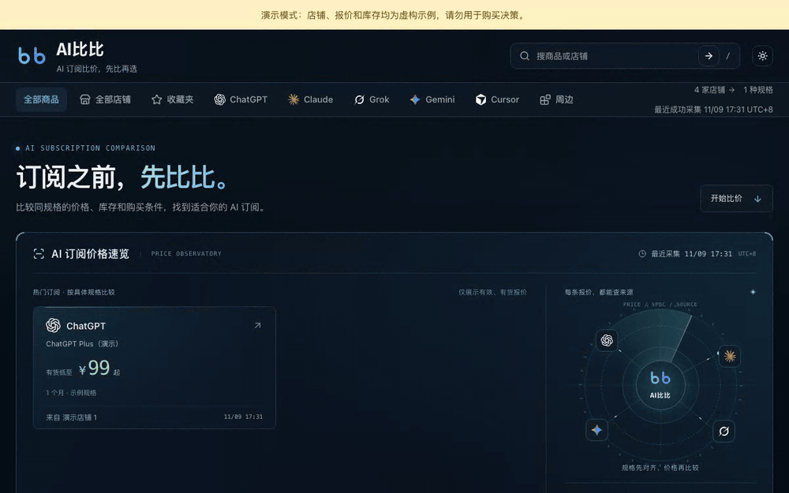
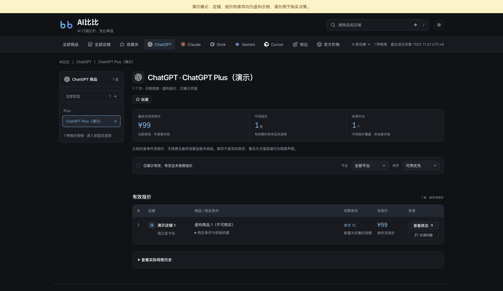
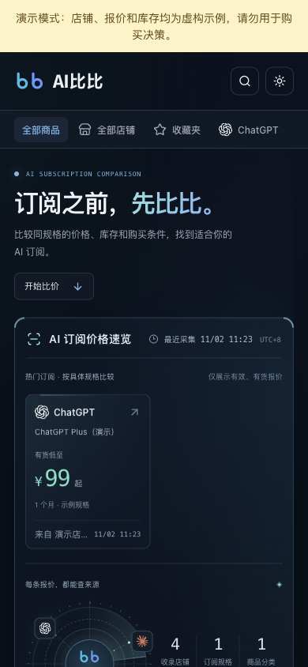

# AI比比 · AI Subscription Comparison

[English](README.en.md) · 简体中文

**同一个 AI 订阅，在哪里买最划算？** AI比比 把 ChatGPT、Claude、Gemini 等订阅按相同规格对齐，比较各家店铺的价格、库存和购买条件，并对照各地区官方价。每条报价都能查到来源和采集时间。

代码可以自行部署：Python 采集与审核 · React + Vite 前端 · Cloudflare Workers + D1。

[](https://github.com/dingxiaopi/aibibi/actions/workflows/quality.yml)
[](LICENSE)

[在线网站 aibibi.app](https://aibibi.app) · [从零到第一条真实报价](public-docs/first-quote.md) · [部署说明](public-docs/deployment.md) · [常见问题](public-docs/troubleshooting.md) · [v0.3.0 发布说明](public-docs/releases/v0.3.0.md)



<sub>画面来自本地演示：店铺、报价与库存为虚构示例；官方价为仓库自带的公开官方价快照。</sub>

## 先运行演示

需要 Node.js 22.18+；普通采集另需 Python 3.9+，加密的 Actions 状态工具需 Python 3.11，支持 macOS / Linux。

```sh
git clone https://github.com/dingxiaopi/aibibi.git
cd aibibi/cloudflare
npm ci
npm run demo
```

打开 <http://127.0.0.1:8787>。演示使用独立本地数据库、虚构店铺与示例报价，不需要 Cloudflare 登录、真实店铺或 AI Key。
已有程序占用端口时，使用 `npm run demo -- --port 8790`。

## 演示截图



<details>
<summary>查看手机端演示</summary>



</details>

## 能做什么

- 按商品规格、来源店铺、库存和购买条件比较报价。
- 首次读取原店详情审核分类，之后沿用商品映射更新价格与库存。
- 保留真实观察时间；过期、缺货、未知库存和未审核记录不参与当前有货最低价。
- 采集逐店落盘、阶段恢复，推送分批校验与断点续传。
- 提供店铺目录、官方地区价格参考、浏览器收藏和报价纠错。
- 自行配置品牌、域名、来源、数据库和可选统计服务。

## 架构

```text
原店公开货架与详情
  → Python 采集 / 首次分类审核
  → 私有实例数据 / 导出包
  → 带鉴权的分批推送
  → Worker + D1
  → SSR 页面 / React 前端 / 公开查询缓存
```

数据更新与代码部署独立。采集默认手动运行，开源仓库不安装定时任务。
也可在自己的私有仓库[用 GitHub Actions 手动或定时采集](public-docs/github-actions.md)，加密保存状态，无需本机持续在线。

## 自己部署

第一次安装请按[从零到第一条真实报价](public-docs/first-quote.md)完成本地实例、原店采集、首次审核和推送验收，再部署自己的 Cloudflare D1、Worker 和密钥。
首次审核可人工完成，不要求 AI Key；日常 Actions 只更新已有映射，不自动批准新商品。配置字段见[配置说明](public-docs/configuration.md)，线上步骤见[部署说明](public-docs/deployment.md)。

默认的 `.local/data/` 保存店铺配置、审核映射、排除记录、采集快照与运行状态，不提交 Git。
仓库包含通用规格定义和虚构演示数据，不包含原运营实例的完整店铺与报价数据。

## 开发与验证

```sh
python3 -m unittest discover -s tests
cd cloudflare
npm ci
npm run check
npm test
npm run build
```

测试使用固定样本和隔离数据库，不向真实店铺发请求。
`npm run build` 构建前端并执行部署 dry-run，不发布网站。

## 文档

- [架构与数据边界](public-docs/architecture.md)
- [从零到第一条真实报价](public-docs/first-quote.md)
- [实例配置](public-docs/configuration.md)
- [部署与演示](public-docs/deployment.md)
- [采集与适配器贡献](public-docs/collectors.md)
- [官方地区价、税费与手动采集](public-docs/official-prices.md)
- [GitHub Actions 采集](public-docs/github-actions.md)
- [常见问题与反馈](public-docs/troubleshooting.md)
- [版本发布流程](public-docs/release.md)
- [贡献指南](CONTRIBUTING.md) · [安全反馈](SECURITY.md)

## 许可与来源

代码采用 [MIT](LICENSE)。数据与品牌范围分别见 [数据说明](DATA_POLICY.md)、[品牌说明](TRADEMARKS.md)。
图标、字体等保留各自的 [第三方授权与归属](THIRD_PARTY_NOTICES.md)。

仅采集公开或已获授权的原店信息，不绕过访问控制，不复制竞品数据。报价反映采集时观察，购买前应回原店确认最终价格、库存和售后条件。
